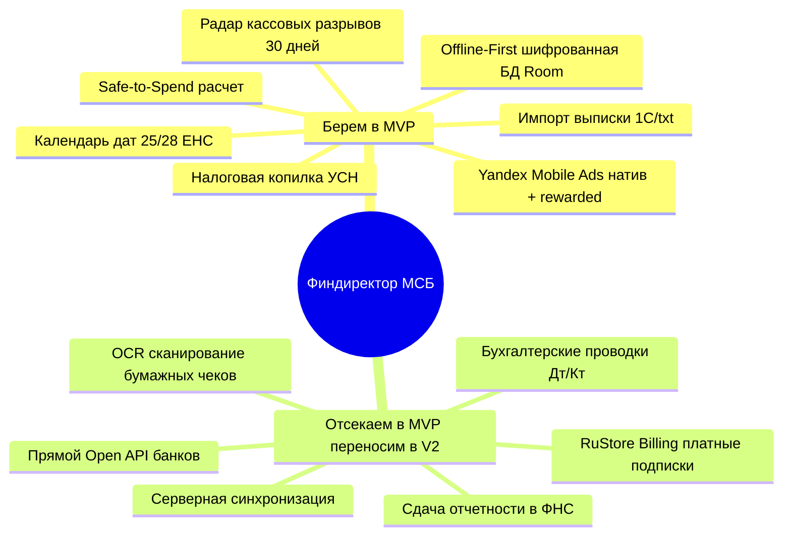
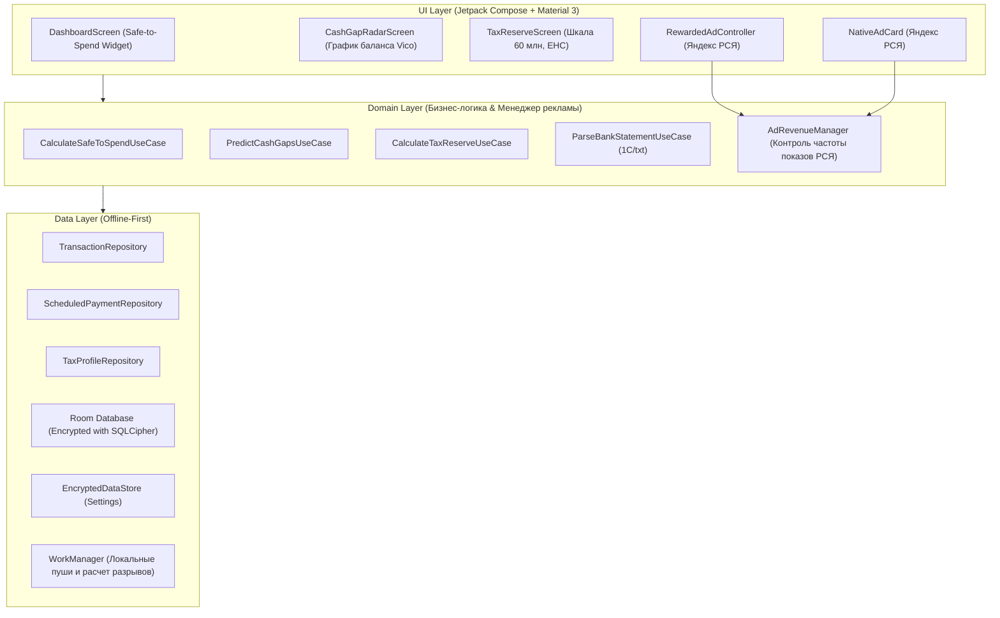

# Архитектура Android-приложения «Финдиректор для МСБ» (Safe-to-Spend, Налоги, Кассовые разрывы)

## Goal Description
Создание легковесного автономного Android-приложения (мобильного финансового аналитика) для предпринимателей малого и микробизнеса в РФ (ИП, самозанятые с оборотом, сервисные и торговые микропредприятия).

Приложение решает проблему «финансовой слепоты» предпринимателя за счет трех взаимосвязанных модулей:
1. **«Безопасный остаток» (Safe-to-Spend):** отделение собственных денег бизнеса от чужих авансов и зарезервированных платежей.
2. **«Налоговая копилка»:** виртуальное резервирование налогов (УСН 6%, 15%, патент, шкала порога 60 млн ₽) и контроль критических дат (25 и 28 числа).
3. **«Радар кассовых разрывов»:** прогнозный 30-дневный календарь будущих кассовых просадок.

**Бизнес-модель и юридический статус:**
* **Статус разработчика:** Самозанятый (Плательщик НПД).
* **Монетизация:** Рекламная Сеть Яндекса (РСЯ / Yandex Mobile Ads SDK).
* **Канал дистрибуции:** RuStore (как бесплатное приложение с рекламой).

---

## User Review Required

> [!IMPORTANT]
> **Идеальная совместимость: Самозанятость + RuStore + РСЯ**  
> 1. В RuStore самозанятые могут свободно публиковать **бесплатные приложения**.  
> 2. Яндекс официально и напрямую сотрудничает с самозанятыми разработчиками: доход от рекламы выплачивается на карту физлица, а Яндекс автоматически регистрирует доходы и формирует чеки в сервисе «Мой налог» (налог 6% при работе с российским юрлицом ООО «Яндекс»).  
> 3. Вам **не нужно** открывать ИП и **не нужно** подключать сложный RuStore Billing SDK.

> [!TIP]
> **Форматы рекламы для B2B / Финтеха (чтобы не раздражать предпринимателей):**  
> В финансовых инструментах агрессивная реклама (fullscreen-баннеры при каждом клике) приводит к мгновенным удалениям.  
> В архитектуру приложения закладываются два экологичных формата:  
> 1. **Нативная реклама (Native In-Feed Ads):** аккуратные карточки предложений для бизнеса (РКО, лизинг, сервисы отчетности, факторинг), органично встроенные в ленту платежного календаря.  
> 2. **Вознаграждаемая реклама (Rewarded Video):** показ видео по желанию пользователя взамен на расширенную функцию (например: *«Посмотреть ролик, чтобы выгрузить годовой отчет P&L в Excel»* или *«Смоделировать прогноз разрывов на 90 дней вместо 30»*).

---

## Границы проекта (Scope)



### ✅ Берем в MVP (In-Scope)
1. **Ядро Safe-to-Spend:** автоматический вычет из фактического баланса налогового буфера, незакрытых авансов по проектам и обязательных регулярных платежей на 14 дней.
2. **Налоговая копилка:**
   * Профили: УСН 6% (Доходы), УСН 15% (Доходы минус расходы), Патент.
   * Шкала приближения к порогу 60 млн ₽ (индикатор НДС).
   * Уведомления за 5 и 1 день до 25 (подача уведомления ЕНС) и 28 (списание) числа месяца.
3. **Радар кассовых разрывов:** визуальный график прогноза баланса на 30 дней с красной зоной риска.
4. **Импорт выписок:** парсинг стандартного файла `1c_to_kl.txt` (поддерживается всеми банками РФ: Т-Банк, Точка, Сбер, Альфа, ВТБ).
5. **Монетизация через РСЯ:**
   * Интеграция `com.yandex.android:mobileads`.
   * Блок нативной рекламы на главном экране / в календаре.
   * Rewarded Ads для разблокировки экспорта отчетов.
6. **Автономность (Offline-First):** полная приватность, локальная БД на Room c шифрованием SQLCipher.

---

## Архитектура Android-приложения



### Технологический стек:
* **Язык разработки:** Kotlin 2.x
* **UI фреймворк:** Jetpack Compose + Material Design 3
* **Управление состоянием:** MVI (Model-View-Intent) с использованием Kotlin Coroutines и `StateFlow`
* **Локальная база данных:** Room + SQLCipher (полное шифрование базы на мобильном устройстве)
* **Графика и аналитика:** Vico Charts (нативная библиотека графиков под Jetpack Compose)
* **Фоновые процессы:** Android Jetpack `WorkManager` (проверка дат налогов и кассовых разрывов)
* **Рекламный SDK:** `Yandex Mobile Ads SDK v7.x` (`com.yandex.android:mobileads`)

---

## Интеграция Yandex Mobile Ads SDK (РСЯ)

### 1. Подключение зависимостей
```kotlin
// build.gradle.kts (Module: app)
dependencies {
    implementation("com.yandex.android:mobileads:7.7.0")
    // Дополнительно для нативной рекламы в Compose
    implementation("com.google.android.ads:mediation-test-suite:3.0.0") // опционально для отладки
}
```

### 2. Инициализация в Application классе
```kotlin
class App : Application() {
    override fun onCreate() {
        super.onCreate()
        MobileAds.initialize(this) {
            // SDK инициализирован, готов к загрузке объявлений
        }
    }
}
```

### 3. Сценарии интеграции:
* **Нативная карточка (Native Ads):** отображается внизу главного экрана дашборда или как элемент списка в платежном календаре. Стиль шрифтов и кнопок полностью адаптируется под Material 3 палитру приложения.
* **Rewarded Video:** перед экспортом отчета или аналитики вызывается проверка:
  ```kotlin
  fun onExportReportClicked(activity: Activity, onUnlocked: () -> Unit) {
      adManager.showRewardedAd(activity) { reward ->
          onUnlocked()
      }
  }
  ```

---

## Публикация в RuStore для Самозанятого

### 1. Создание аккаунта разработчика
* Вход в RuStore Консоль через VK ID.
* Выбор статуса: **Физическое лицо / Самозанятый**.
* Заполнение анкеты разработчика (паспортные данные, ИНН, привязка статуса самозанятого).
* В RuStore приложение публикуется как **Бесплатное** (Free).

### 2. Требования модерации к приложениям с рекламой
* **Декларация рекламы:** При создании карточки приложения в консоли RuStore обязательно установить тумблер: **«Приложение содержит рекламу»** и указать категорию используемого SDK (`Yandex Mobile Ads SDK`).
* **Закон о маркировке рекламы (ОРД):** Яндекс автоматически маркирует рекламу, присваивает токены (erid) и передает отчеты в ЕРИР. С вашей стороны ручных действий по маркировке не требуется.
* **Политика конфиденциальности (ФЗ-152):**  
  Обязательна рабочая ссылка на политику конфиденциальности в карточке приложения. В документе указывается:
  1. Финансовые данные пользователя хранятся локально на устройстве и не передаются третьим лицам.
  2. Для показа рекламы используется Yandex Mobile Ads SDK, который может собирать технические идентификаторы устройства (Advertising ID) в соответствии с правилами Яндекса.
* **Разрешения в AndroidManifest:**
  ```xml
  <uses-permission android:name="android.permission.INTERNET" />
  <uses-permission android:name="android.permission.ACCESS_NETWORK_STATE" />
  <uses-permission android:name="com.google.android.gms.permission.AD_ID" />
  ```

### 3. Требования к сборке и релизу
* **Формат:** AAB (Android App Bundle) или универсальный APK.
* **Подпись:** Keystore (RSA 2048+ или EC), ключ необходимо сохранить для дальнейших обновлений.
* **Сроки проверки:** Автоматическая антивирусная проверка Лаборатории Касперского + ручная проверка модераторами RuStore (обычно 1–3 дня).

---

## Verification Plan

### Автоматические тесты
1. **Unit-тесты бизнес-логики (JUnit 5 + Truth):**
   * Расчет формулы `SafeToSpend` при разных налоговых режимах.
   * Детектор кассовых разрывов (проверка интервалов наступления дефицита).
   * Парсер формата банковских выписок `1c_to_kl.txt` (тестовые файлы Т-Банк, Точка, Сбер).
2. **Интеграционные тесты рекламы:**
   * Проверка состояния `AdRevenueManager` при отсутствии интернет-соединения (приложение не должно падать или блокировать пользователя, если реклама не загрузилась).

### Ручная проверка
1. **Тестовые рекламные блоки Яндекса:**  
   Использование официальных Demo Block ID Яндекса для проверки показа Native Ads и Rewarded Video на физическом Android-устройстве.
2. **Сквозной сценарий пользователя:**  
   Импортировать выписку -> настроить налог 6% -> увидеть безопасный остаток -> добавить плановый платеж аренды -> проверить срабатывание радара кассового разрыва.
